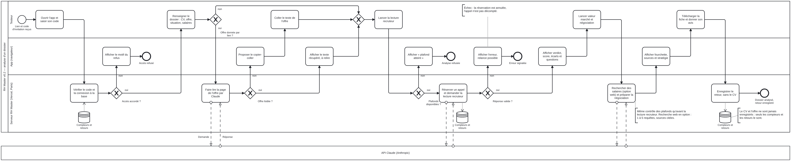

# Modèle BPMN — analyse d'un dossier (v0.2)

| Fichier | Usage |
|---|---|
| `analyse-dossier.bpmn` | Source au format BPMN 2.0, modifiable dans [bpmn.io](https://demo.bpmn.io) (glisser le fichier dans la page) ou Camunda Modeler |
| `analyse-dossier.svg`, `analyse-dossier.png` | Rendu du diagramme, pour la documentation et le portfolio |

## Ce que montre le diagramme

- **Trois couloirs** pour l'app : le testeur, l'app dans son navigateur, le serveur RH Master (Vercel, Paris). **L'API Claude (Anthropic)** est un participant externe : le serveur lui envoie une demande et reçoit une réponse (flux de messages en pointillés).
- **Quatre décisions** : accès accordé (code valide et base connectée), offre donnée par lien, offre lisible, plafonds disponibles et réponse valide.
- **Trois sorties en échec**, toutes signalées au testeur : accès refusé, analyse refusée (plafond atteint), erreur de Claude (appel non décompté).
- **La base Upstash** ne reçoit que des compteurs et des retours : le CV et l'offre ne sont jamais enregistrés.

## Correspondances avec le dossier BA

| Élément du diagramme | Règle ou story |
|---|---|
| Vérifier le code et la connexion à la base | RG-A07, APP-18 |
| Faire lire la page de l'offre par Claude | APP-17 |
| Plafonds disponibles ?, réservation annulée en cas d'échec | RG-A04, APP-18 |
| Rechercher des salaires (option web) | RG-A02, APP-19 |
| Enregistrer le retour, sans le CV | RG-A01, RG-A06, APP-11 |

Mettre ce modèle à jour quand le parcours change (nouvelle étape, nouveau contrôle).
